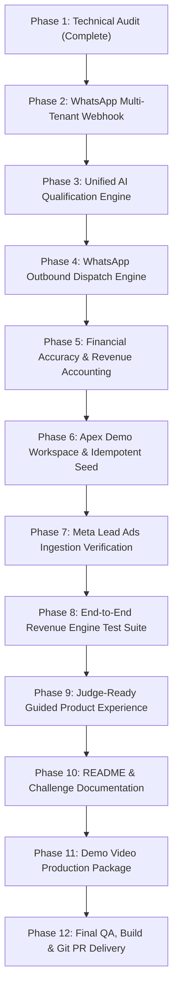

# CloseCraft Technical Remediation & Architecture Audit
**Document ID:** `CC-AUDIT-2026-V1`  
**Date:** November 19, 2026  
**Auditor:** Principal SaaS Architect & AI Systems Engineering Review  
**Target Application:** CloseCraft Revenue Operating System (`https://closecrafthq.com`)  
**Repository:** `https://github.com/zeerocodez/closecraft`  

---

## 1. Executive Summary & Architecture Overview

CloseCraft is engineered as a unified, multi-tenant AI revenue operating system that connects public inbound acquisition (Marketing Website, Meta Lead Ads, WhatsApp Webhooks, Embeddable Widgets) with a SaaS Sales Command Centre, AI Qualification Engine, and Workforce Management.

### High-Level Architecture
```
[Inbound Channels]
  ├── Public Website Forms & Calculator
  ├── Embeddable JavaScript Lead Widget
  ├── WhatsApp Cloud API Webhook
  └── Meta Lead Ads (Facebook & Instagram)
          │
          ▼
[Ingestion & Security Gate]
  ├── HMAC-SHA256 Signature Validation (Meta, WhatsApp, Bachs)
  ├── Distributed Rate Limiting (PostgreSQL RateLimit table)
  ├── Tenant Identifier Resolution (Page ID / Phone Number ID / Slug)
  └── Multi-Tenant Boundary Check (Row-Level Security & Org Isolation)
          │
          ▼
[Revenue Engine Core]
  ├── Canonical AI Qualification Service (OpenAI GPT-4o / Zod Structured Output)
  ├── Explainable Signal Derivation (Intent, Fit, Urgency, Value)
  ├── Organization Qualification Policy Enforcement
  ├── Next Best Action Generator (RESPOND, ASSIGN_HUMAN, NURTURE, BOOK_DEMO)
  └── Actor Assignment Model (AI, AUTOMATION, HUMAN CLOSER, HUMAN SETTER)
          │
          ▼
[SaaS Sales Command Centre & Workforce]
  ├── Attention Pods ("What needs attention right now?")
  ├── Multi-Channel Inbox & Active Conversation Threading
  ├── CRM Pipeline (Opportunity, Proposal, Negotiation, Won, Lost)
  ├── Revenue Leakage Detection (SLA Breaches, Stalled Deals, No Next Action)
  └── Controlled WhatsApp Outbound Follow-Up Dispatch (Pilot Dry-Run Guard)
```

---

## 2. In-Depth Component Audit & Defect Matrix

The comprehensive audit identified six major technical vulnerabilities, architectural fragmentations, and data integrity risks across the system:

| ID | Component | File & Function | Severity | Root Cause | Business & Security Impact | Proposed Correction | Verification Test |
| :--- | :--- | :--- | :---: | :--- | :--- | :--- | :--- |
| **AUD-01** | WhatsApp Ingestion | `src/app/api/webhooks/whatsapp/route.ts`<br>`processWhatsAppMessage()` | **CRITICAL** | Hardcoded lookup for `slug: 'zeerocodes'` with secondary fallback to `findFirst({ where: { status: 'APPROVED' } })`. | Cross-tenant data leakage. Incoming prospect inquiries to one business are injected into another client's workspace. | Resolve organization strictly by `phoneNumberId` matching `Organization.whatsappPhoneNumberId` or verified provider config. Quarantine unmapped events; never use default orgs. | `tests/whatsapp_multitenant_isolation.test.cjs` |
| **AUD-02** | Meta / Facebook Webhook | `src/app/api/webhooks/facebook/route.ts`<br>`POST()` | **HIGH** | Unmapped Facebook pages fall back to oldest approved organization (`orderBy: { createdAt: 'asc' }`). Asynchronous Inngest dispatch lacks direct execution fallback. | Leads from unmapped Meta pages contaminate the primary merchant account. Leads may sit unanalyzed if Inngest is offline. | Enforce strict page-to-organization resolution. Quarantine unmapped pages. Synchronously invoke `RevenueEngine.processNewLead` upon lead ingestion. | `tests/meta_lead_ads_ingestion.test.cjs` |
| **AUD-03** | AI Qualification Services | `src/lib/ai/qualificationEngine.ts`<br>`processLeadWithAI()` vs `extractor.ts` vs `qualification.ts` | **HIGH** | Three disconnected qualification services. WhatsApp webhook uses a mock rule engine with hardcoded text (`$99/month`) rather than the structured AI extractor. | Inconsistent lead scoring. Prospects receive misleading AI messages and incorrect intent scores bypassing merchant policies. | Establish `extractLeadQualificationData` as the single canonical qualification engine. Remove mock qualification implementations from production. | `tests/unified_ai_qualification.test.cjs` |
| **AUD-04** | Follow-Up Dispatch | `src/app/api/cron/follow-ups/route.ts`<br>`src/lib/whatsapp.ts` | **HIGH** | Background cron prints `[WhatsApp API Mock]` and marks tasks `EXECUTED` without calling WhatsApp Cloud API or tracking real delivery states. | Follow-ups are logged as executed even though messages never reach the prospect's device. | Implement WhatsApp Cloud API client with tenant credentials, template adherence, opt-out validation, and explicit lifecycle states (`PENDING`, `SENT`, `FAILED`, `CANCELLED`). Support dry-run mode for pilot safety. | `tests/whatsapp_outbound_dispatch.test.cjs` |
| **AUD-05** | Financial Value Accounting | `src/lib/revenue-engine/engine.ts`<br>`src/app/(saas)/dashboard/page.tsx`<br>`src/app/(saas)/pipeline/` | **MEDIUM** | Inconsistent distinction between estimated pipeline opportunity values, prospect-stated budgets, and verified realised revenue. | Misleads business owners and evaluators by presenting speculative pipeline estimates as verified income. | Enforce strict financial categorization: Stated Budget, Estimated Opportunity, Qualified Pipeline, Proposal Value, Closed-Won Contract, and Verified Realised Revenue (backed by Bachs/Paystack records). Display "Not yet established" when unknown. | `tests/financial_accuracy_and_reporting.test.cjs` |
| **AUD-06** | Demonstration Workspace | `scripts/purge-demo-data.js`<br>`src/app/(saas)/actions.ts` | **HIGH** | Absence of an isolated, complete demonstration organization leaves evaluators and judges with empty workspaces. | Prospective customers and judges cannot immediately experience the complete value loop without manual setup. | Provision dedicated demo organization (`Apex Professional Services`, `slug: apex-demo`) with 12 distinct lead scenarios, full sales team, active chats, and Revenue Engine intelligence. | `tests/demo_workspace_isolation.test.cjs` |

---

## 3. Detailed Audit Findings

### Issue 1: WhatsApp Multi-Tenant Routing Contamination
- **File and Function:** `src/app/api/webhooks/whatsapp/route.ts` -> `processWhatsAppMessage()` (lines 104–118).
- **Root Cause:**
  ```typescript
  let org = await db.organization.findFirst({ where: { slug: 'zeerocodes' } });
  if (!org) {
    org = await db.organization.findFirst({ where: { plan: 'FREE_PILOT', status: 'APPROVED' } });
  }
  ```
  The webhook handler explicitly ignores the incoming `phoneNumberId` extracted from `change.value.metadata.phone_number_id` and arbitrarily chooses the first approved organization in the database.
- **Business Impact:** In a multi-tenant environment, a customer inquiring about real estate via Merchant B's WhatsApp number will have their contact and conversation saved to Merchant A's CRM workspace.
- **Proposed Correction:**
  1. Add `whatsappPhoneNumberId` and `whatsappBusinessAccountId` to `Organization` in Prisma schema if not already present.
  2. Resolve the organization by `where: { whatsappPhoneNumberId: phoneNumberId }` or explicit provider mapping.
  3. Reject/quarantine unmapped events with an audit log entry.
  4. Enforce HMAC-SHA256 signature verification using `META_APP_SECRET` / `WHATSAPP_APP_SECRET`.
  5. Check message ID deduplication to prevent duplicate message ingestion.
- **Test Required:** Unit and integration tests with synthetic payloads verifying mapped organizations match, unmapped numbers fail safely, duplicate message IDs are ignored, and cross-tenant pollution is impossible.

---

### Issue 2: Meta / Facebook Lead Ads Webhook Fallback
- **File and Function:** `src/app/api/webhooks/facebook/route.ts` -> `POST` (lines 142–174).
- **Root Cause:**
  ```typescript
  if (!org) {
    org = await db.organization.findFirst({
      where: { status: 'APPROVED' },
      orderBy: { createdAt: 'asc' },
    });
  }
  ```
  When an incoming LeadGen event from Facebook or Instagram cannot be mapped by `facebookPageId`, it falls back to the earliest created approved organization. Furthermore, lead creation only emits an Inngest event and does not directly invoke `RevenueEngine.processNewLead`.
- **Business Impact:** Unmapped ad leads are assigned to the wrong organization. In serverless or local environments without an Inngest worker running, leads remain unqualified in a `NEW` status without signals or next actions.
- **Proposed Correction:**
  1. Remove the arbitrary `findFirst` fallback. If unmapped, log and drop the event.
  2. Directly invoke `RevenueEngine.processNewLead(lead.id)` immediately after lead upsert.
  3. Ensure Graph API token retrieval is tenant-scoped via `org.metaAccessToken`.
- **Test Required:** `tests/meta_lead_ads_ingestion.test.cjs` validating signature verification, exact org matching, unmapped page rejection, and immediate Revenue Engine evaluation.

---

### Issue 3: Fragmented and Competing AI Qualification Engines
- **File and Function:** `src/lib/ai/qualificationEngine.ts` vs `src/lib/ai/extractor.ts` vs `src/lib/ai/qualification.ts`.
- **Root Cause:**
  - `qualificationEngine.ts` contains a local mock heuristic that inspects strings like `"price"` or `"buy"` and returns hardcoded answers: `"Our pricing starts at $99/month for the basic package..."`.
  - `whatsapp/route.ts` calls `processLeadWithAI` from `qualificationEngine.ts`.
  - `capture/route.ts` and `leads/route.ts` call `RevenueEngine.processNewLead` which calls `extractLeadQualificationData` from `extractor.ts`.
  - `qualification.ts` defines an alternative `qualifyLead` function.
- **Business Impact:** Leads from WhatsApp receive inaccurate, hardcoded $99 pricing messages that conflict with Nigerian Naira pricing, bypass the merchant's qualification policy, and do not generate standardized Revenue Signals or Next Best Actions.
- **Proposed Correction:**
  1. Retire the mock `processLeadWithAI` from production execution.
  2. Direct all channels (Website, WhatsApp, Meta, Ingest) through `RevenueEngine.processNewLead`.
  3. Use `extractLeadQualificationData` as the single canonical AI extractor with structured Zod output, tenant policy adherence, and deterministic fallback when offline.
  4. Ensure all AI recommendations generate an auditable assessment, explicit evidence, target role (`CLOSER` vs `SETTER`), and Next Best Action.
- **Test Required:** `tests/unified_ai_qualification.test.cjs` asserting that WhatsApp and web leads yield identical signal types, evidence structures, and policy-compliant outcomes.

---

### Issue 4: Follow-Up Automation Lacks Real Outbound Dispatch
- **File and Function:** `src/app/api/cron/follow-ups/route.ts` (lines 41–48, 119–120).
- **Root Cause:**
  - Follow-up cron updates `followUpTask` status to `EXECUTED` without actually sending anything.
  - Follow-up conversations log `[WhatsApp API Mock] Sending Automated Follow-Up...` to the server console.
- **Business Impact:** The application claims follow-ups are happening, but prospects receive nothing. Alternatively, if automated dispatch is accidentally enabled, messages could be sent without template compliance or consent verification.
- **Proposed Correction:**
  1. Implement a genuine WhatsApp Cloud API messaging client in `src/lib/whatsapp.ts`.
  2. Check communication consent and opt-out status (`optedOutOfMarketing`).
  3. Verify the 24-hour customer service window for session messages; enforce approved templates for messages outside the 24-hour window.
  4. Maintain explicit delivery states: `PENDING`, `PROCESSING`, `SENT`, `DELIVERED`, `FAILED`, `CANCELLED`.
  5. Provide a safe `PILOT_MODE` / dry-run toggle (`process.env.WHATSAPP_LIVE_DISPATCH_ENABLED !== 'true'`) that records the message with state `DRY_RUN_LOGGED` without claiming external delivery.
- **Test Required:** `tests/whatsapp_outbound_dispatch.test.cjs` testing payload generation, dry-run logging, opt-out prevention, and error handling.

---

### Issue 5: Financial Value Ambiguity (Opportunity vs Verified Revenue)
- **File and Function:** `src/lib/revenue-engine/engine.ts`, `src/app/(saas)/dashboard/page.tsx`, `src/app/(saas)/pipeline/`.
- **Root Cause:**
  - `estimatedValue` on leads is an AI or form-derived estimate.
  - In certain reporting views, sum of deal amounts is labeled as "Revenue" or "Won Revenue" without verifying that actual payment receipts or invoices exist.
- **Business Impact:** Overstates business revenue and damages credibility with users and investors.
- **Proposed Correction:**
  1. Explicitly partition financial values into distinct categories:
     - `Stated Budget`: Value provided by prospect during inquiry.
     - `Estimated Opportunity`: AI-derived valuation (labeled with `(Est.)` or `Not yet established`).
     - `Pipeline Value`: Weighted sum of active open opportunities.
     - `Closed-Won Contract Value`: Total signed contract volume.
     - `Verified Realised Revenue`: Payments reconciled with Bachs/Paystack receipts.
  2. Never display zero or unstated values as arbitrary numbers; display `Not yet established`.
- **Test Required:** `tests/financial_accuracy_and_reporting.test.cjs` validating that unstated leads show no fake values and won deals without payment records do not count as realised revenue.

---

### Issue 6: Demonstration Environment & Judge Walkthrough
- **File and Function:** `scripts/purge-demo-data.js`, `src/app/(saas)/actions.ts`.
- **Root Cause:** Previously, demo records were mixed with customer records or purged completely for production, leaving evaluators with an empty workspace.
- **Business Impact:** Reviewers, judges, and prospective clients cannot experience CloseCraft's value without configuring a business from scratch.
- **Proposed Correction:**
  1. Create a dedicated demonstration organization: `Apex Professional Services` (`slug: apex-demo`), isolated from customer tenants.
  2. Populate with 12 distinct lead scenarios demonstrating the full revenue recovery loop (new inbound, high intent, stalled deal, awaiting proposal, scheduled demo, opted out, etc.).
  3. Provision 7 team members (Owner, Manager, 3 Closers, 2 Setters).
  4. Provide a guided, judge-ready walkthrough experience directly in the UI (`/demo` or `/today`).
- **Test Required:** `tests/demo_workspace_isolation.test.cjs` validating clean tenant boundaries, idempotency, and scenario completeness.

---

## 4. Remediation Plan & Execution Sequence



Proceeding directly to Phase 2 implementation.
